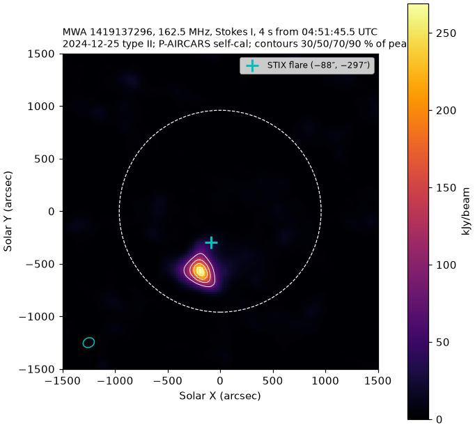
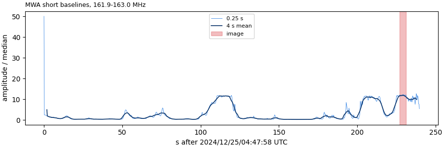

# Archive events: one image per burst

Plan: `docs/burst-imaging-plan.md`. Coarse channel 127 (162.5 MHz), 4 s at the
maximum of the MWA short-baseline light curve, P-AIRCARS self-cal, no AOFlagger.
Made with `scripts/calculon/event_image.sh`.

| event (UTC) | MWA obs | phase | calibrator | 4 s image | peak | peak/rms | position (half-max centroid) | T_B (RJ, beam) | status |
|---|---|---|---|---|---|---|---|---|---|
| 2024-12-25 type II | 1419137296 (OA004) | III, 94 of 120 tiles | 1419161128 PKS2356-61 (+6.6 h) | 04:51:45.5–49.5 | 2.69×10⁵ Jy/beam | 144 | (−187″, −572″), 0.63 R☉ projected | 1.3×10⁹ K | done 20 Oct |

## 2024-12-25 type II (1419137296)

- One compact source, about 2.8 beams above half maximum (beam 110″ × 90″),
  in the south of the disk. It lies about 290″ south-southwest of the STIX flare
  position (−88″, −297″; STIX M6 / GOES M5.0, Earth time). A type II source high
  in the corona is not expected to sit above the flare in projection; this is an
  observation, not yet an interpretation.
- Off-Sun rms 1.9×10³ Jy/beam (r > 2500″).
- **To check before trusting the brightness:** the light curve at 162.5 MHz has
  three flat-topped maxima at the same level (11–12 × median), at about 110 s,
  200–215 s and 228–235 s after 04:47:58. Equal flat tops could mean clipping in
  the receiver or correlator. Not confirmed. The chain picked the last one
  (228 s), which is only a few percent above the others and 9 s before the end of
  the observation.
- T_B is Rayleigh–Jeans from the restoring beam, not cross-checked against the
  quiet Sun for this observation.

Files on calculon: image
`/scratch/andre_csillaghy/paircars/out/1419137296_ch127/20241225/1419137296_target/imagedir_f_1.28_t_4.0_pol_I_w_briggs_0.0_peak4s/pbcor_hpcs/`,
status `~/mwa/events/1419137296.md`.
