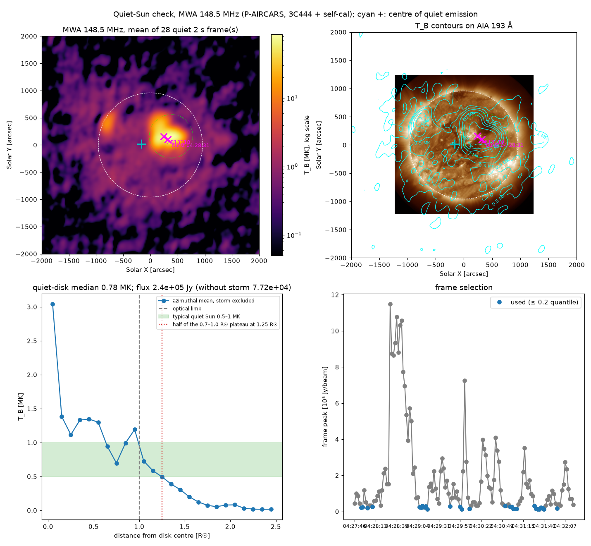
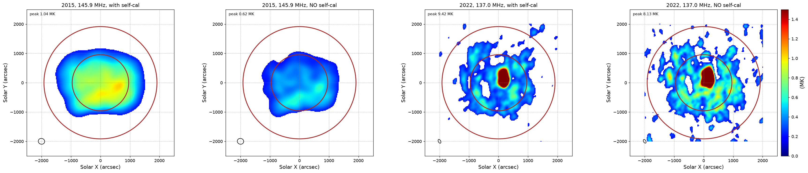

# Progress, 5–9 October 2026: first archive flare (2022-09-30) and P-AIRCARS on calculon

Branch `claude/flare-20220930` (PR #3). Plan context and item numbers:
`solar-radio-imaging-spectroscopy/docs/progress-2026-10-09.md`. Science results:
`solar-radio-imaging-spectroscopy/docs/handover-2022-09-30-science-results.md`.
Not part of the Sharma reproduction (`reproduction-plan.md`, unchanged).

## What was built

| Area | Files | Status |
|---|---|---|
| Solar imaging on calculon (hyperdrive DI + wsclean, one 4 s step, Sun-centred) | `scripts/calculon/flare-image.sbatch` (`SUN_OBSID`, `CAL_OBSID`, `CHANNEL`, `PEAK_UTC`, `RESET_FLAGS`) | working |
| Restore bursts flagged by AOFlagger | `src/solarburst/reflag.py` | working (flags and weights) |
| MWA dynamic spectrum | `src/solarburst/dynspec.py`, `scripts/calculon/dynspec.sbatch` (array) | working, 17 obs |
| Helioprojective resampling, AIA/STIX overlays | `src/solarburst/maps.py::radec_to_hpc`, `scripts/flare_overlay.py` | working |
| P-AIRCARS vs hyperdrive comparison | `scripts/compare_paircars.py` | working |
| Unattended runs with mail notifications | `scripts/calculon/overnight/` (`overnight.sh`, `burst10.sh`, `extract-all.sbatch`, `wide-field.sbatch`, `make_cube.py`, `montage.py`) | working |
| Astrometry against GGSM | `scripts/calculon/overnight/gleam_check.py` | runs; inconclusive in solar fields; crashes on the 3C444 field (NaN guard missing) |
| Quiet-Sun flux check | `scripts/calculon/overnight/quiet_sun_flux.py`, `scripts/quiet_sun_check.py` | working (see update below) |
| Movies and grids | `scripts/burst_movie.py` (on AIA), `scripts/burst_movie_mwa.py` (Stonyhurst grid) | working |
| PFSS field lines | `scripts/pfss_fieldlines.py` (sunkit-magex 1.2.0, added to `environment.yml`) | working |
| P-AIRCARS install and Slurm | `scripts/calculon/paircars-dev-install.sbatch`, `paircars-env.sh`, `paircars-bin/sinfo` | working |

## Documentation

- `docs/calculon-mwa.md`: login-node rule; "Running jobs: what we learned"
  (Apptainer `--bind /scratch`, `OPENBLAS_NUM_THREADS=1` for wsclean, `sbatch`
  rather than `srun`, Slurm-mail notifier, channel-list change); job table.
- `docs/calculon-paircars.md`: developer-mode install, Slurm setup, Prefect
  and Postgres (recovery race, timeouts), runs, local patches, first results.
- `docs/paircars-upstream.md`: draft for the P-AIRCARS developers (not sent).
- `docs/asvo-request-1348547272.md`: 0.25 s ASVO job 1109734 and commands.

## Results (figures in `figures/flare20220930/`)

- 03:57:24, 144.6 MHz: source on AR 13110; M1.1 (NE limb, confirmed by STIX)
  radio-quiet.
- 04:28:44 type III at 143.4 MHz: hyperdrive (peak/rms 56), P-AIRCARS 3C444
  only (70), P-AIRCARS self-cal (312); positions agree.
- 24 channels at 04:28:44 (21 usable), 10 × 4 s at 148.5 MHz, movies on AIA
  and with Stonyhurst grid.
- Height ≈ 1.2 R☉ (19-channel centroids, 346″ ± 22″) and open PFSS field lines
  from the west edge of AR 13110 through the source.

## Update, 12–13 October: quiet-Sun calibration check

P-AIRCARS imaged the whole burst observation 1348547272 (04:27:42–04:32:22) at
148.5 MHz in 2 s steps (136 images; 3C444 + self-cal). The 28 quietest frames
(lowest 20 % of frame peaks, spread over the observation) are averaged
(`scripts/quiet_sun_check.py --quantile 0.2`; map on a log scale).

- Quiet disk 0.78 MK and radio-disk half radius 1.25 R☉, both as expected for
  the quiet Sun near 150 MHz: the amplitude scale is about right.
  *Superseded (19 Oct):* this was an early check on a storm-dominated
  observation. The 14–15 Oct tests below are the current result: the 2022
  self-calibrated scale is 0.35 MK at 137.0 MHz and uncertain by about ×1.5–2.
- Flux outside the storm 7.7 × 10⁴ Jy against 2.8–5.6 × 10⁴ Jy for a uniform
  1.1 R☉ disk at 0.5–1 MK; the excess includes the storm wings and a source on
  the NE limb, so this is not a calibration error.
- The noise storm over AR 13110 (≈ 86 MK) is present in every frame; this
  observation has no truly quiet Sun. A fainter source sits on the NE limb near
  the STIX M1.1 position (−869″, +412″); not yet examined.
- **137.0 MHz, two observations, two calibrators (13–14 Oct).** ch107 is the
  channel closest to the burst that both channel lists share.

  

  | | early obs 1348543720 | burst obs 1348547272 |
  |---|---|---|
  | data | 03:30:12–03:33:08, one 176 s image | 28 quietest of 136 × 2 s frames |
  | calibrator | PKS0408-65 (1348522216) | 3C444 (1348574416) |
  | quiet disk (median, r < 0.8 R☉) | 0.36 MK, flat to the limb | 0.43 MK (storm wings) |
  | at 0.7–0.8 R☉ | ≈ 0.37 MK | ≈ 0.37 MK |
  | radio disk half level | 1.45 R☉ | 1.25 R☉ |
  | total flux | 3.8 × 10⁴ Jy (expected 2.4–4.7 × 10⁴) | 1.7 × 10⁵ Jy (storm) |
  | storm over AR 13110 | 9 MK | 85 MK |

  The two calibrators give the same flux scale within 15–20 %. Figures:
  `quiet_sun_ch107_early.png`, `quiet_sun_ch107_burstobs.png`,
  `quiet_sun_ch107_compare.png` (`scripts/quiet_sun_compare.py`).
- **Against the literature.** Sharma & Oberoi (2020, ApJ; arXiv:2009.10604),
  MWA quiet Sun 2015-12-03 03:39–03:44: disk-averaged 0.62 MK (132 MHz),
  0.63 MK (145 MHz), effective radius ≈ 27′ (T_B > 0.2 MK), absolute flux
  calibration after Oberoi et al. (2017). Our disk is ≈ 0.6× theirs while our
  total flux is as expected: our emission is spread wider (beam 141″ × 82″).
  To compare like with like, their observation 1133149192 and 3C444 1133161488
  (same day, 07:04) were requested from ASVO on 14 Oct (jobs 1113526/1113527;
  4 s, 160 kHz, 80 kHz edges, AOFlagger off) for P-AIRCARS at ch113
  (144.6 MHz, the same channel as our early obs). Rohit's own MSs of that day
  (`/mnt/nas05/data02/rohit/20151203_MWA*`) are old cotter products with two
  coarse channels merged, calibrated on Cen A.
- Pitfall: `--timerange` must lie inside the unflagged data, otherwise P-AIRCARS
  makes no images (`docs/calculon-paircars.md`).

The combined MWA + e-Callisto spectrogram (STIX-MWA) now draws each MWA coarse
channel at its true frequency, gaps left empty, plus one row per channel.

## Update, 14–15 October: why is the 2022 quiet Sun fainter than the published one?

Reference: Sharma & Oberoi (2020) quiet Sun, 2015-12-03 03:39–03:44, 0.63 MK at
145 MHz (absolute flux calibration). Their observation 1133149192 and 3C444
1133161488 were converted by ASVO (jobs 1113526/1113527: 4 s, 160 kHz, 80 kHz
edges, AOFlagger off), downloaded to calculon and run through P-AIRCARS
(`scripts/calculon/overnight/quiet2015_chain.sh`). Maps in their style:
`scripts/tb_map_sharma_style.py`.

| test | 2015 (1133149192, 145.9 MHz) | 2022 (1348543720, 137.0 MHz) | conclusion |
|---|---|---|---|
| P-AIRCARS, 3C444 / PKS0408-65 + self-cal | **0.58 MK**, smooth (paper: 0.63) | 0.35 MK, patchy | pipeline reproduces the paper |
| short baselines (< 200 λ) of 2015 thinned to the 2022 counts | 0.78 → 0.76 MK, still smooth | — | not the short baselines |
| 2015 imaging settings on 2022 data (pixel, maxuv 1401 λ, taper) | — | 0.30 → 0.31 MK | not the imaging settings |
| 13 min instead of 4.7 min (three obs, 03:18–03:33) | — | 0.30 → 0.23 MK | not the integration time |
| **no self-cal** (calibrator only) | **0.37 MK**, smooth | **0.42 MK**, patchy | calibrator-only scales agree |
| no self-cal, long baselines cut (2361 → 1400 → 700 λ) | — | 0.37 / 0.39 / 0.36 MK; scatter 48 / 42 / 34 % (2015: 17 %) | long baselines add some patchiness, not the level |

(Tests 2–4 and 6 use plain wsclean images without primary-beam correction:
compare within a row, not across rows. Disk = r < 0.8 R☉, storm ± 400″ excluded.)

What we know now:

- **Calibrator-only flux scales agree between 2015 and 2022** (0.37 vs 0.42 MK).
  The 2022 data and calibration are not "too faint".
- **Amplitude self-calibration sets the final brightness**, and it acts
  differently: ×1.6 in 2015 (to the published value), ×0.85 in 2022. In 2022
  the sky is dominated by the noise storm (6–9 MK, 20–30× the disk); in 2015
  the brightest feature is 1 MK. Which of the two self-calibrated scales is
  right in absolute terms is not settled by our data; Sharma's independent
  absolute calibration agrees with the 2015 one.
- **The 2022 disk is patchy with or without self-cal** (scatter 34–48 % vs 17 %
  in 2015). Cutting the long baselines helps only a little. The hole west of
  disk centre stays in every version and may be a real coronal hole (dark in
  AIA 193 Å); not yet checked.
- For the burst images (self-calibrated, storm present) the absolute T_B scale
  is uncertain by a factor of about 1.5–2. Positions and relative brightness
  are not affected.
- Open: how P-AIRCARS's amplitude self-cal fixes the flux scale on a
  storm-dominated sky (`--only_amplitude`, `--no_ap_selfcal`); a question for
  the P-AIRCARS developers / Rohit.

Figures: `figures/quiet2015/` (`selfcal_test`, `uvtest_1133149192_ch114`,
`longcut_2022`, `highlight_quiet_2015_vs_2022`),
`figures/flare20220930/quiet_long_settings`. Scripts: `uv_hist.py`,
`uv_thin.py`, `uv_test.sbatch`, `quiet_settings.sbatch`, `quiet2022_long.sh`
(all in `scripts/calculon/overnight/`), `scripts/uv_test_compare.py`,
`scripts/quiet_settings_compare.py`.

Mistakes on the way, now fixed: P-AIRCARS time ranges set a few seconds past the
valid data (imaging refuses them; `docs/calculon-paircars.md`); a chain that did
not wait for its extraction job; two starts of the same run
(`burst_series.sh` now locks per TAG). Slurm mail from calculon never arrived;
status files only.

## Known problems

- P-AIRCARS per-channel flux jumps (×100); ch173–187 fail.
- Absolute astrometry not validated.
- The 03:57 image was made before reflagging.
- `overnight.sh` misreports a job that Slurm refused (missing `#!` in a
  generated script) as completed; P-AIRCARS imaged only the first range of a
  comma-separated `--timerange`.

## Next

ASVO job 1109734 (0.25 s) → download to calculon → 0.25 s images; polcal;
flux scale; astrometry on 3C444; next archive event.
